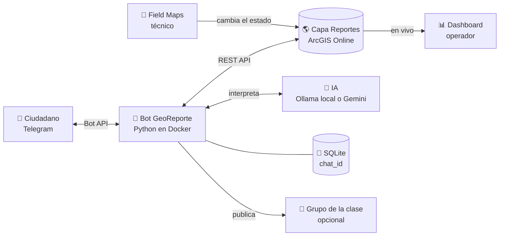
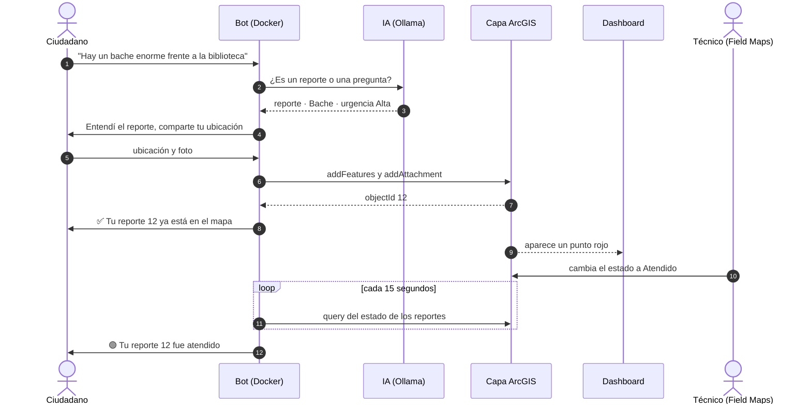
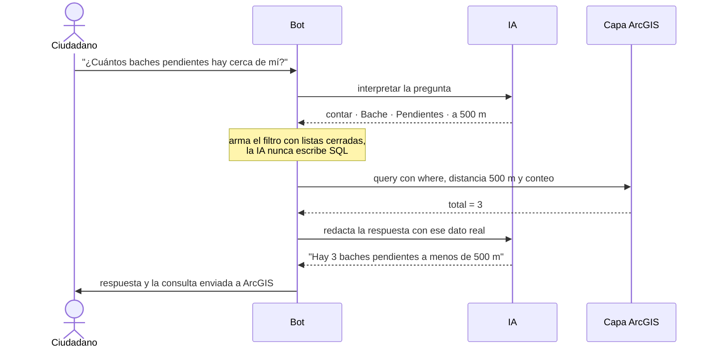
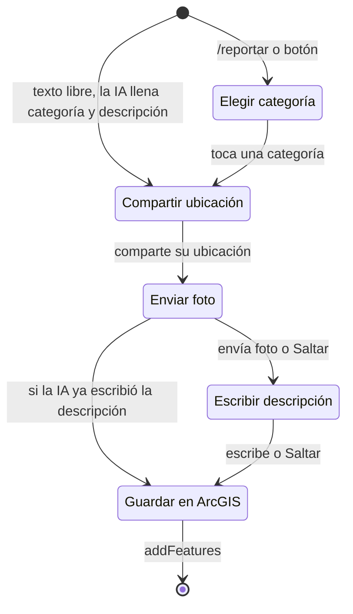
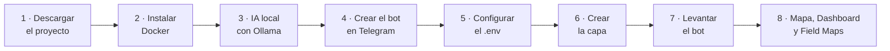

<p align="center">
  
</p>

<h1 align="center">GeoReporte · Telegram + ArcGIS</h1>

<p align="center">
  
  
  
  
  
  
  
</p>

<p align="center">
  Un bot de Telegram que convierte los mensajes de los ciudadanos en puntos de un mapa de ArcGIS,<br>
  y les avisa cuando un técnico atiende su reporte.
</p>

---

## Contenido

1. [Qué es y qué hace](#1-qué-es-y-qué-hace)
2. [Cómo funciona](#2-cómo-funciona)
3. [Requisitos](#3-requisitos)
4. [Instalación desde cero](#4-instalación-desde-cero)
5. [Cómo se usa](#5-cómo-se-usa)
6. [Demo en clase](#6-demo-en-clase)
7. [Estructura del proyecto](#7-estructura-del-proyecto)
8. [Problemas comunes](#8-problemas-comunes)
9. [Retos para seguir aprendiendo](#9-retos-para-seguir-aprendiendo)

---

## 1. Qué es y qué hace

GeoReporte es un kit práctico para mostrar **integraciones con ArcGIS**. Conecta tres sistemas que no se conocen entre sí, sin modificar ninguno:

| Sistema | Rol |
|---|---|
| **Telegram** | La aplicación del ciudadano: desde ahí reporta y recibe avisos |
| **ArcGIS Online** | Donde viven los reportes: capa, Dashboard y Field Maps |
| **IA** (Ollama local o Gemini) | Entiende mensajes escritos con palabras normales |

El **bot** es el intermediario (middleware): corre en Docker en tu computadora y traduce entre los tres.

**Lo que puede hacer un ciudadano:**

- 📍 **Reportar con botones:** categoría, ubicación, foto y descripción.
- 🤖 **Reportar hablando normal:** *"hay un hueco enorme frente a la biblioteca"*. La IA saca la categoría, la urgencia y la descripción, y el bot solo pide la ubicación.
- 🔎 **Preguntarle al mapa:** *"¿cuántos baches pendientes hay cerca de mí?"*. La IA convierte la pregunta en una consulta a ArcGIS y responde con los datos reales.
- 🔔 **Recibir avisos:** cuando un técnico cambia el estado en Field Maps, el bot le escribe "tu reporte fue atendido".
- 📋 **Ver sus reportes** con su estado actual.

**Lo que ve el operador:** un Dashboard de ArcGIS que se llena en vivo, con puntos que cambian de color según su estado: 🔴 Nuevo, 🟠 En proceso y 🟢 Atendido.

---

## 2. Cómo funciona

### 2.1 Arquitectura



Dentro del contenedor, `main.py` maneja la conversación, `arcgis_client.py` habla con la REST API de ArcGIS, `ia.py` con el modelo de IA y `store.py` con el registro local.

Tres ideas clave:

1. **Nadie toca la base de datos de nadie.** El bot habla con ArcGIS solo por su REST API, y con Telegram solo por su Bot API.
2. **Cada sistema es dueño de su información.** El reporte (punto, foto, estado) vive en ArcGIS. El identificador de Telegram de cada persona (`chat_id`) vive solo en el registro local del bot. Por eso la capa puede mostrarse en público sin exponer datos personales.
3. **No hace falta una URL pública.** El bot usa *long polling*: es él quien le pregunta a Telegram si hay mensajes nuevos y quien escribe en ArcGIS. Funciona desde cualquier laptop con internet, sin túneles ni servidores.

### 2.2 Recorrido de un reporte



### 2.3 Preguntarle al mapa



Con `MOSTRAR_CONSULTA=true`, el bot muestra debajo de cada respuesta la consulta exacta que envió, por ejemplo:

```
🔎 Consulta a ArcGIS: contar · where: categoria = 'Bache' AND estado <> 'Atendido' · a 500 m de tu ubicación
```

### 2.4 La conversación paso a paso



En cualquier paso: `/cancelar` descarta el reporte, `/reportar` empieza uno nuevo, y si la persona envía algo inesperado el bot le explica qué falta. Un reporte abandonado se descarta a los 15 minutos.

### 2.5 Operaciones de ArcGIS que usa

| Operación REST | Cuándo se usa | Archivo |
|---|---|---|
| `generateToken` | Al iniciar y cuando el token vence | `arcgis_client.py` |
| `createService` + `addToDefinition` | Una vez, al crear la capa | `crear_capa.py` |
| `addFeatures` | Al guardar un reporte | `arcgis_client.py` |
| `addAttachment` | Si el reporte trae foto | `arcgis_client.py` |
| `query` por `OBJECTID` | Cada 15 s, para detectar cambios de estado | `arcgis_client.py` |
| `query` con `where`, `distance` y `outStatistics` | Preguntas al mapa | `arcgis_client.py` |

### 2.6 Niveles de integración que muestra

| Pieza | Nivel | Por qué |
|---|---|---|
| El bot crea puntos, sube fotos y consulta estados | **Servicios** | Usa la REST API del Feature Service, nunca la base de datos |
| La IA interpreta mensajes y preguntas | **Servicios** | Es otro servicio que el bot orquesta junto con ArcGIS |
| El aviso de "atendido" | **Flujo de trabajo** | Un cambio en ArcGIS dispara una acción en Telegram |
| `/mapa` envía el enlace del Dashboard | **Aplicación** | Enlace entre aplicaciones |
| — | **Datos** | No se usa: ningún sistema accede al almacenamiento de otro |

---

## 3. Requisitos

| Qué | Para qué | Obligatorio |
|---|---|---|
| [Docker Desktop](https://www.docker.com/products/docker-desktop/) | Correr el bot | Sí |
| Cuenta de **ArcGIS Online** tipo Creator o superior | Crear la capa, el mapa y el Dashboard | Sí |
| **Telegram** en el celular | Crear el bot y usarlo | Sí |
| [Ollama](https://ollama.com) con un modelo descargado | IA local, gratis y sin nube | Opcional |
| API key de [Google AI Studio](https://aistudio.google.com) | IA en la nube, entiende audios | Opcional |
| **ArcGIS Field Maps** en un celular | Hacer de técnico que atiende reportes | Opcional |

Sin IA, el bot funciona igual con botones.

---

## 4. Instalación desde cero



### Paso 1 · Descargar el proyecto

```bash
git clone https://github.com/TU_USUARIO/telegram-arcgis.git
cd telegram-arcgis
```

O descarga el `.zip`, descomprímelo y abre una terminal dentro de la carpeta. En Windows: clic derecho en la carpeta, **Abrir en Terminal**.

### Paso 2 · Instalar Docker

1. Instala [Docker Desktop](https://www.docker.com/products/docker-desktop/). En Windows acepta usar **WSL 2**.
2. Ábrelo y espera a que diga **Engine running**.
3. Verifica:

```bash
docker --version
docker compose version
```

### Paso 3 · IA local con Ollama (opcional)

1. Instala [Ollama](https://ollama.com) y descarga el modelo:

```bash
ollama pull qwen2.5:7b
ollama list
```

2. Abre en el navegador `http://localhost:11434`. Debe decir **Ollama is running**.

> **¿Qué modelo usar?** `qwen2.5:7b` entiende bien el español y respeta el formato JSON que necesita el bot. Si tu computadora no tiene tarjeta gráfica y responde lento, prueba `qwen2.5:3b`.

> **¿Prefieres la nube?** Crea una API key en [aistudio.google.com](https://aistudio.google.com) con **Get API key** y en el paso 5 usa `IA_PROVEEDOR=gemini`. Gemini además entiende audios.

### Paso 4 · Crear el bot en Telegram

1. En Telegram busca **@BotFather** (tiene la marca de verificado) y envía `/newbot`.
2. Escribe el **nombre** visible, por ejemplo `GeoReporte`.
3. Escribe el **usuario**: debe terminar en `bot`, por ejemplo `GeoReporte_bot`.
4. Copia el **token** que te entrega. Trátalo como una contraseña.
5. Opcional, para que se vea mejor: envía `/setcommands`, elige tu bot y pega:

```
start - Bienvenida
reportar - Crear un nuevo reporte
misreportes - Ver el estado de mis reportes
mapa - Ver el mapa en vivo
cancelar - Cancelar el reporte en curso
```

También puedes ponerle foto con `/setuserpic` y descripción con `/setdescription`.

### Paso 5 · Configurar el `.env`

Copia la plantilla:

```bash
# Windows (PowerShell)
Copy-Item .env.example .env

# macOS / Linux
cp .env.example .env
```

Abre `.env` y completa los valores, sin comillas y sin espacios alrededor del `=`:

| Variable | Qué poner | Obligatoria |
|---|---|---|
| `TELEGRAM_TOKEN` | El token de BotFather | Sí |
| `ARCGIS_PORTAL` | `https://www.arcgis.com`, o la URL de tu portal Enterprise | Sí |
| `ARCGIS_USERNAME` / `ARCGIS_PASSWORD` | Tu cuenta de ArcGIS | Sí, salvo que uses API key |
| `ARCGIS_API_KEY` | Solo si tu cuenta entra con SSO (ver problemas comunes) | No |
| `ARCGIS_LAYER_URL` | La llenas en el paso 6 | Sí |
| `MAPA_URL` | Enlace público del Dashboard; el bot lo envía tras cada reporte | No |
| `GRUPO_CHAT_ID` | Id del grupo de la clase (ver paso 9) | No |
| `IA_PROVEEDOR` | `ollama`, `gemini` o vacío para no usar IA | No |
| `OLLAMA_URL` | `http://host.docker.internal:11434` | Si usas Ollama |
| `OLLAMA_MODEL` | `qwen2.5:7b` | Si usas Ollama |
| `GEMINI_API_KEY` / `GEMINI_MODEL` | Tu key y `gemini-3.5-flash-lite` | Si usas Gemini |
| `MOSTRAR_CONSULTA` | `true` muestra la consulta enviada a ArcGIS | No |
| `INTERVALO_REVISION_SEG` | Cada cuántos segundos revisa cambios de estado (`15`) | No |

> ⚠️ El `.env` tiene tu contraseña y tu token: no lo compartas ni lo subas a GitHub. El `.gitignore` ya lo excluye.

### Paso 6 · Crear la capa en ArcGIS Online

```bash
docker compose run --rm bot python crear_capa.py
```

La primera vez Docker construye la imagen (1 o 2 minutos). Al final verás:

```
ARCGIS_LAYER_URL=https://services.arcgis.com/.../FeatureServer/0
```

Copia esa línea en tu `.env`. La capa queda **privada** y con esta estructura:

| Campo | Tipo | Valores |
|---|---|---|
| `categoria` | Texto | Bache, Alumbrado, Basura, Agua, Semaforo, Otro |
| `descripcion` | Texto (500) | Lo que escribió el ciudadano o resumió la IA |
| `estado` | Texto con dominio | Nuevo, En proceso, Atendido |
| `urgencia` | Texto con dominio | Alta, Media, Baja |
| `fecha` | Fecha | Momento del reporte |
| `fuente` | Texto | Telegram o Telegram + IA |

Además tiene adjuntos habilitados para las fotos y simbología por estado.

> **¿Ya tenías la capa de una versión anterior?** Agrégale el campo `urgencia` una sola vez con `docker compose run --rm bot python actualizar_capa.py`.

### Paso 7 · Levantar el bot

```bash
docker compose up -d --build
docker compose logs -f
```

Debes ver algo así:

```
INFO bot: Bot iniciado. Capa: https://services.../FeatureServer/0 · IA: qwen2.5:7b (local, Ollama)
INFO bot: Conectado a Telegram como @GeoReporte_bot → https://t.me/GeoReporte_bot
INFO ia: Modelo local qwen2.5:7b listo en 3 s
```

Ahora, **desde el celular** (en Telegram de escritorio no se puede enviar la ubicación):

1. Abre `https://t.me/TU_BOT` y toca **Iniciar**.
2. Escribe *"hay un bache enorme en la calle"*, comparte tu ubicación y manda una foto.
3. El bot responde "✅ Tu reporte ya está en el mapa" y en los logs aparece `Reporte 1 creado`.
4. En ArcGIS Online, en la pestaña **Datos** de la capa, cambia el `estado` a **Atendido**. En unos 15 segundos te llega el aviso.

Si los cuatro pasos funcionan, la integración está completa.

### Paso 8 · Mapa, Dashboard y Field Maps

**Mapa web**

1. Abre la capa en Map Viewer.
2. Configura la ventana emergente: título `{categoria}`; campos `descripcion`, `estado`, `urgencia` y `fecha`; y el elemento de adjuntos para ver la foto.
3. En las propiedades de la capa activa **Intervalo de actualización: 0,5 min** (el mínimo para capas alojadas).
4. Guárdalo como *Mapa Reportes Ciudadanos*.

**Dashboard**

Crea uno con estos elementos:
- un mapa;
- un indicador con el total de reportes;
- un gráfico por `categoria`;
- un gráfico por `estado`;
- una lista de los últimos reportes ordenados por `fecha`.

Pon el QR del bot en un elemento de texto para que los estudiantes lo escaneen desde el proyector.

**Field Maps (el técnico)**

El mismo mapa web funciona en ArcGIS Field Maps. El técnico toca un punto, cambia `estado` y envía. Sin Field Maps, puedes cambiar el estado desde la tabla de atributos en Map Viewer.

**Mapa público para los celulares (opcional)**

1. En la página del ítem de la capa, elige **Crear capa de vista**.
2. En la vista, desactiva la edición y compártela como **Público**.
3. Arma un Dashboard sobre esa vista, compártelo como Público y pon su enlace en `MAPA_URL`.

La capa original sigue privada y editable.

### Paso 9 · Grupo de la clase (opcional)

Con un grupo, todos ven en el celular los reportes de todos:

1. Crea un grupo de Telegram y agrega tu bot como miembro.
2. Dentro del grupo escribe `/chatid`. El bot responde con un número como `-1001234567890`.
3. Ponlo en `GRUPO_CHAT_ID` del `.env` y aplica con `docker compose up -d --force-recreate`.

Desde entonces el bot publica en el grupo cada reporte nuevo (con foto) y cada reporte atendido.

---

## 5. Cómo se usa

### Comandos

| Comando o botón | Qué hace |
|---|---|
| `/start` | Bienvenida |
| `/reportar` o **📍 Nuevo reporte** | Reporte guiado con botones |
| Texto libre | La IA decide si es un reporte o una pregunta |
| `/misreportes` o **📋 Mis reportes** | Tus últimos 10 reportes con su estado actual |
| `/mapa` | Enlace al mapa o Dashboard en vivo |
| `/cancelar` | Descarta el reporte en curso |
| `/chatid` | Muestra el id del chat (para configurar el grupo) |
| `https://t.me/TU_BOT?start=reportar` | Enlace (o QR) que abre el bot directo en un reporte nuevo |

### Ejemplos de mensajes para la IA

| Mensaje | Resultado |
|---|---|
| *"Hay basura acumulada en la esquina desde hace días"* | Reporte: Basura, urgencia Media |
| *"Un semáforo no funciona y casi chocan dos autos"* | Reporte: Semáforo, urgencia Alta |
| *"¿Cuántos reportes hay?"* | Conteo total |
| *"¿Qué reportes hay cerca de mí?"* | Lista a menos de 500 m (pide tu ubicación) |
| *"¿Qué problema se reporta más hoy?"* | Desglose por categoría de las últimas 24 h |
| *"Muéstrame los urgentes pendientes"* | Lista filtrada por urgencia y estado |

### Comandos útiles de Docker

| Comando | Para qué |
|---|---|
| `docker compose logs -f` | Ver en vivo cada mensaje, lo que entendió la IA y cada consulta |
| `docker compose ps` | Confirmar que el bot está corriendo |
| `docker compose up -d --force-recreate` | Aplicar cambios del `.env` |
| `docker compose up -d --build` | Aplicar cambios del código |
| `docker compose restart` | Reiniciar el bot |
| `docker compose down` | Apagar el bot |
| `docker compose down -v` | Apagar y borrar el registro local (para empezar limpio) |

---

## 6. Demo en clase

| Minuto | Qué pasa |
|---|---|
| 0 a 1 | Proyecta el Dashboard vacío con el QR del bot |
| 1 a 4 | Todos reportan desde el celular: los puntos rojos aparecen frente a la clase |
| 4 a 5 | Muestra `docker compose logs -f`: *"esto es el middleware, recibe Telegram y habla REST con ArcGIS"* |
| 5 a 7 | Alguien pregunta *"¿qué reportes hay cerca de mí?"* y se ve la consulta que la IA armó |
| 7 a 9 | En Field Maps cambias reportes a En proceso y Atendido: los puntos cambian de color y a sus dueños les suena el celular |
| 9 a 10 | Cierre: *"Telegram no sabe nada de ArcGIS y ArcGIS no sabe nada de Telegram. No modificamos ninguno: los conectamos."* |

Antes de la clase, ensaya con 3 o 4 personas reportando a la vez y vacía la capa de pruebas.

---

## 7. Estructura del proyecto

```
telegram-arcgis/
├── imgs/
│   └── telegram.png          # imagen de resumen
├── docker-compose.yml        # el contenedor del bot y su volumen de datos
├── .env.example              # plantilla de configuración
├── GUIA_ESTUDIANTES.md       # hoja de práctica para la clase
└── bot/
    ├── Dockerfile
    ├── requirements.txt
    └── app/
        ├── main.py             # conversación de Telegram, preguntas y avisos de estado
        ├── arcgis_client.py    # middleware con ArcGIS: token, addFeatures, addAttachment, query
        ├── ia.py               # IA intercambiable: Ollama (local) o Gemini (nube)
        ├── store.py            # registro local reporte ↔ chat_id (SQLite)
        ├── crear_capa.py       # crea la Hosted Feature Layer
        └── actualizar_capa.py  # agrega el campo urgencia a una capa existente
```

---

## 8. Problemas comunes

Casi todo se diagnostica con `docker compose logs -f`.

| Síntoma | Causa | Solución |
|---|---|---|
| El bot no responde nada | Le escribes a otro bot | Compara el `@usuario` de la línea `Conectado a Telegram como` con el bot que abres |
| `Capa:` aparece vacío o `Invalid URL '/query'` | Falta `ARCGIS_LAYER_URL` en el `.env` | Pega la URL de la capa y usa `docker compose up -d --force-recreate` |
| `No se pudo obtener token` | Contraseña incorrecta, o tu cuenta entra con SSO o MFA | Revisa el `.env`; con SSO crea una API key con acceso a la capa y ponla en `ARCGIS_API_KEY` |
| `No se pudo conectar con Ollama` | Ollama solo acepta conexiones de tu propia computadora | Define la variable de entorno `OLLAMA_HOST=0.0.0.0`, reabre Ollama y reinicia el bot |
| La IA tarda mucho | El modelo corre solo con el procesador | Usa `qwen2.5:3b`, o Gemini |
| `402 ... prepayment credits are depleted` | El proyecto de tu key de Gemini no tiene saldo | Recarga saldo en AI Studio, o crea la key en un proyecto sin facturación (nivel gratuito) |
| "Con el modelo local no entiendo audios" | Los modelos de Ollama de este proyecto solo leen texto | Escribe el mensaje, o usa Gemini |
| No aparece el botón **Enviar mi ubicación** | Estás en Telegram de escritorio | Usa el celular |
| `Conflict: terminated by other getUpdates request` | El mismo bot corre en dos lugares | Deja una sola copia encendida |
| El Dashboard no se actualiza solo | Falta el intervalo de actualización | Actívalo en Map Viewer (0,5 min) y guarda el mapa |
| No llega el aviso de Atendido | El reporte se creó antes de un `down -v` | Normal: el bot solo vigila los reportes que él registró |
| ArcGIS Enterprise | Otra URL de portal | `ARCGIS_PORTAL=https://tu-servidor/portal` |

---

## 9. Retos para seguir aprendiendo

| Reto | Pista |
|---|---|
| Agregar la categoría **Árbol caído** | Diccionario `CATEGORIAS` en `main.py` y la lista `CATEGORIAS` en `ia.py` |
| Responder con la **dirección** del reporte | Servicio `reverseGeocode` de ArcGIS Location Services |
| Detectar **duplicados** | Antes de `addFeatures`, una `query` de la misma categoría a menos de 50 m |
| Comando **/ranking** | `query` con `outStatistics` agrupando por un campo nuevo de alias |
| **Audios con IA local** | Un contenedor con Whisper que transcribe antes de llamar a Ollama |
| Cambiar el sondeo por **webhooks** | Webhooks de Feature Service en lugar de revisar cada 15 s |
| Otro canal: **WhatsApp** o **Teams** | Solo cambia `main.py`; `arcgis_client.py` queda igual |

---

<p align="center"><b>¿ArcGIS + … ?</b> Hoy fue Telegram. ¿Cuál es el siguiente sistema?</p>