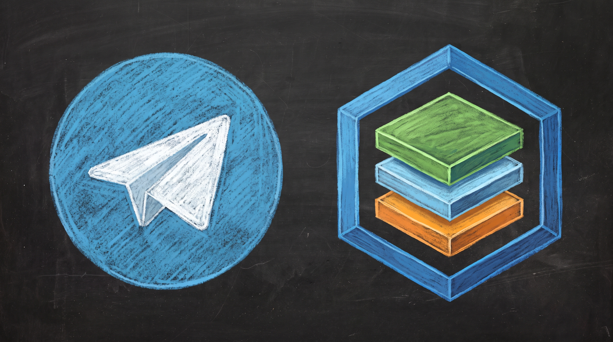
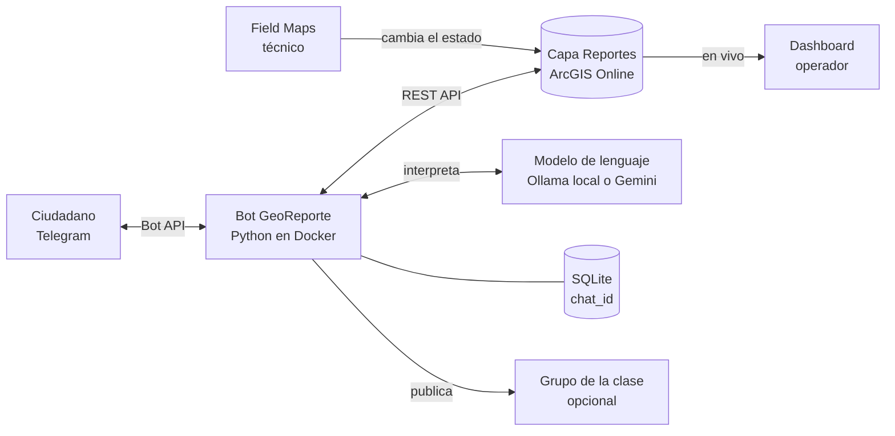
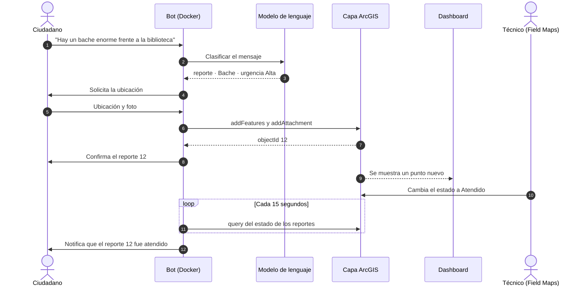
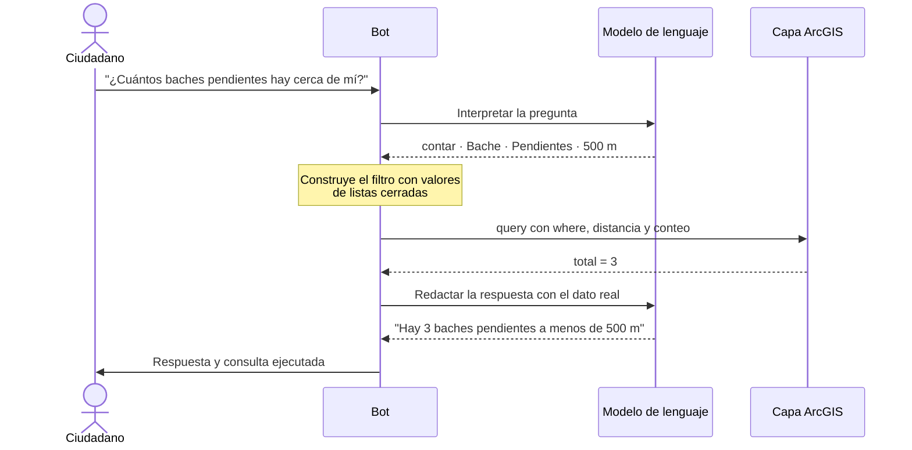
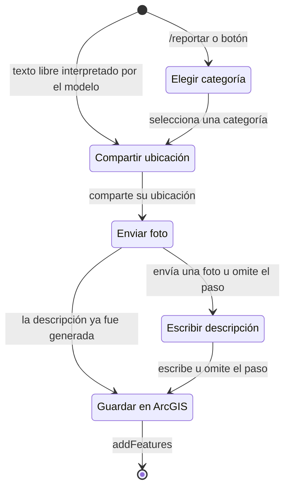
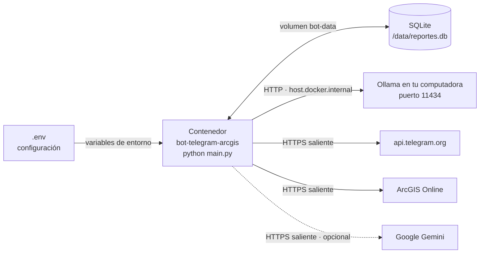
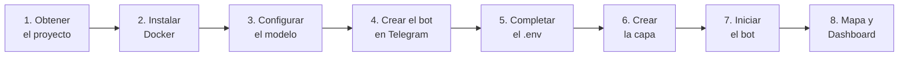
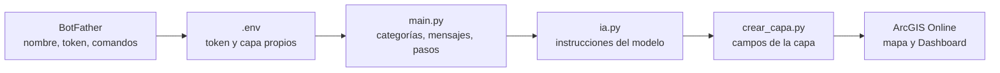

<p align="center">
  
</p>

<h1 align="center">GeoReporte · Telegram + ArcGIS</h1>

<p align="center">
  
  
  
  
  
  
  
</p>

<p align="center">
  Integración de referencia entre Telegram, ArcGIS Online y un modelo de lenguaje:<br>
  los ciudadanos reportan incidencias urbanas desde Telegram, los reportes se publican en una capa de ArcGIS<br>
  y el bot notifica al ciudadano cuando un técnico atiende su caso.
</p>

---

## Contenido

1. [Descripción general](#1-descripción-general)
2. [Arquitectura y funcionamiento](#2-arquitectura-y-funcionamiento)
3. [Qué levanta Docker](#3-qué-levanta-docker)
4. [Descripción de los archivos](#4-descripción-de-los-archivos)
5. [Requisitos](#5-requisitos)
6. [Instalación paso a paso](#6-instalación-paso-a-paso)
7. [Uso del bot](#7-uso-del-bot)
8. [Crear tu propio flujo](#8-crear-tu-propio-flujo)
9. [Operación y monitoreo](#9-operación-y-monitoreo)
10. [Demostración en clase](#10-demostración-en-clase)
11. [Solución de problemas](#11-solución-de-problemas)
12. [Seguridad](#12-seguridad)
13. [Extensiones sugeridas](#13-extensiones-sugeridas)

---

## 1. Descripción general

GeoReporte es un kit práctico para demostrar **integraciones con la plataforma ArcGIS**. Conecta tres sistemas independientes sin modificar ninguno de ellos:

| Sistema | Rol en la solución |
|---|---|
| **Telegram** | Interfaz del ciudadano: envía reportes, hace preguntas y recibe notificaciones |
| **ArcGIS Online** | Sistema de registro: la capa de reportes, el Dashboard del operador y Field Maps del técnico |
| **Modelo de lenguaje** (Ollama local o Google Gemini) | Interpreta mensajes escritos en lenguaje natural |

Entre ellos se ubica el **bot**, un servicio en Python que actúa como *middleware*: recibe los mensajes de Telegram, consulta al modelo de lenguaje cuando hace falta y escribe o consulta en ArcGIS a través de su REST API.

**Funcionalidades para el ciudadano**

- **Reporte guiado:** elige una categoría, comparte su ubicación, adjunta una foto y escribe una descripción.
- **Reporte en lenguaje natural:** escribe, por ejemplo, *"hay un hueco enorme frente a la biblioteca"*. El modelo identifica la categoría, estima la urgencia y redacta la descripción; el bot solo solicita la ubicación.
- **Consultas sobre el mapa:** pregunta, por ejemplo, *"¿cuántos baches pendientes hay cerca de mí?"*. El modelo traduce la pregunta a una consulta de ArcGIS y responde con los datos reales.
- **Notificaciones:** cuando un técnico cambia el estado del reporte, el bot le escribe al ciudadano.
- **Seguimiento:** consulta el estado actual de sus últimos reportes.

**Funcionalidades para la operación**

- Un Dashboard de ArcGIS que se actualiza en vivo, con simbología por estado: Nuevo (rojo), En proceso (naranja) y Atendido (verde).
- ArcGIS Field Maps para que el técnico consulte los reportes en campo y actualice su estado.

---

## 2. Arquitectura y funcionamiento

### 2.1 Componentes



Principios de diseño:

1. **Integración por servicios.** El bot se comunica con ArcGIS únicamente mediante la REST API del Feature Service, y con Telegram mediante su Bot API. Ningún sistema accede a la base de datos de otro.
2. **Cada sistema es dueño de su información.** El reporte (geometría, atributos, foto y estado) se almacena en ArcGIS. El identificador de Telegram de cada persona (`chat_id`) se almacena solo en el registro local del bot. Por esta razón la capa puede publicarse sin exponer datos personales.
3. **Sin URL pública.** El bot utiliza *long polling*: consulta periódicamente a Telegram si hay mensajes nuevos. Solo realiza conexiones salientes, por lo que funciona en cualquier equipo con acceso a internet, sin abrir puertos ni configurar túneles.
4. **Modelo de lenguaje acotado.** El modelo nunca escribe SQL ni accede a ArcGIS directamente. Devuelve valores elegidos de listas cerradas y el bot construye la consulta.

### 2.2 Recorrido de un reporte



### 2.3 Consultas en lenguaje natural



Con `MOSTRAR_CONSULTA=true`, el bot añade a cada respuesta la consulta enviada a ArcGIS. Es útil con fines didácticos:

```
Consulta a ArcGIS: contar · where: categoria = 'Bache' AND estado <> 'Atendido' · a 500 m de tu ubicación
```

### 2.4 Flujo de la conversación



En cualquier paso, `/cancelar` descarta el reporte y `/reportar` inicia uno nuevo. Si el usuario envía un contenido inesperado, el bot indica qué información falta. Los reportes incompletos se descartan automáticamente a los 15 minutos.

### 2.5 Operaciones de la REST API de ArcGIS

| Operación | Momento en que se ejecuta | Archivo |
|---|---|---|
| `generateToken` | Al iniciar y cuando el token expira | `arcgis_client.py` |
| `createService` y `addToDefinition` | Una vez, al crear la capa | `crear_capa.py` |
| `addFeatures` | Al guardar un reporte | `arcgis_client.py` |
| `addAttachment` | Cuando el reporte incluye una foto | `arcgis_client.py` |
| `query` por `OBJECTID` | Cada 15 segundos, para detectar cambios de estado | `arcgis_client.py` |
| `query` con `where`, `distance` y `outStatistics` | Al responder consultas en lenguaje natural | `arcgis_client.py` |

### 2.6 Niveles de integración

| Componente | Nivel | Justificación |
|---|---|---|
| Creación de puntos, carga de fotos y consulta de estados | **Servicios** | Utiliza la REST API del Feature Service, no la base de datos |
| Interpretación de mensajes con el modelo de lenguaje | **Servicios** | Es un servicio adicional que el bot orquesta junto con ArcGIS |
| Notificación de reporte atendido | **Flujo de trabajo** | Un cambio en ArcGIS desencadena una acción en Telegram |
| Comando `/mapa` | **Aplicación** | Enlace entre la aplicación de mensajería y una aplicación de ArcGIS |
| No aplica | **Datos** | Ningún sistema accede al almacenamiento de otro |

---

## 3. Qué levanta Docker

El comando `docker compose up -d --build` construye una imagen y levanta **un único contenedor** llamado `bot-telegram-arcgis`. Ese contenedor ejecuta el bot de forma continua.



### 3.1 Qué ocurre al ejecutar el comando

1. **Construcción de la imagen** (`--build`). Docker toma `bot/Dockerfile`, parte de la imagen oficial `python:3.12-slim`, instala las dependencias de `requirements.txt` y copia el código de `bot/app/`.
2. **Creación del contenedor.** Se cargan las variables del archivo `.env`, se monta el volumen `bot-data` en `/data` y se registra el nombre `host.docker.internal` para que el contenedor pueda llegar a servicios de tu computadora, como Ollama.
3. **Arranque del bot.** El contenedor ejecuta `python main.py`, que:
   - valida la conexión con Telegram e informa el usuario del bot;
   - precarga el modelo de lenguaje en memoria, si está configurado;
   - inicia el ciclo de *long polling* para recibir mensajes;
   - programa una tarea que cada 15 segundos consulta en ArcGIS el estado de los reportes pendientes.
4. **Reinicio automático.** Con la política `restart: unless-stopped`, el contenedor se reinicia si falla o si Docker se reinicia, salvo que lo detengas con `docker compose down`.

### 3.2 Configuración de `docker-compose.yml`

| Clave | Valor | Propósito |
|---|---|---|
| `build` | `./bot` | Construye la imagen a partir de `bot/Dockerfile` |
| `container_name` | `bot-telegram-arcgis` | Nombre fijo para identificar el contenedor |
| `env_file` | `.env` | Inyecta tokens, credenciales y parámetros como variables de entorno |
| `volumes` | `bot-data:/data` | Persiste el registro local (SQLite) entre reinicios y reconstrucciones |
| `extra_hosts` | `host.docker.internal:host-gateway` | Permite al contenedor conectarse a Ollama en el equipo anfitrión |
| `restart` | `unless-stopped` | Reinicia el servicio ante fallos |

El contenedor **no publica puertos**: no recibe conexiones entrantes. Todo el tráfico es saliente.

### 3.3 Conexiones que realiza

| Destino | Protocolo | Para qué |
|---|---|---|
| `api.telegram.org` | HTTPS | Recibir mensajes (long polling) y enviar respuestas |
| ArcGIS Online o ArcGIS Enterprise | HTTPS | Autenticación, creación de entidades, fotos y consultas |
| Ollama en el equipo anfitrión | HTTP, puerto 11434 | Inferencia del modelo local |
| Google Gemini | HTTPS | Inferencia en la nube, solo si se configura |

### 3.4 Ejecuciones puntuales

El script de creación de la capa usa la misma imagen en un contenedor temporal que se elimina al terminar (`--rm`):

```bash
docker compose run --rm bot python crear_capa.py
```

---

## 4. Descripción de los archivos

```
arcgis-telegram/
├── imgs/
│   └── telegram.jpg
├── docker-compose.yml
├── .env.example
├── .gitignore
├── README.md
└── bot/
    ├── Dockerfile
    ├── requirements.txt
    └── app/
        ├── main.py
        ├── arcgis_client.py
        ├── ia.py
        ├── store.py
        └── crear_capa.py
```

### 4.1 Archivos de la raíz

| Archivo | Descripción |
|---|---|
| `docker-compose.yml` | Define el servicio `bot`, su volumen de datos, las variables de entorno y el acceso a Ollama. Detalle en la sección 3. |
| `.env.example` | Plantilla de configuración. Se copia como `.env` y se completa con los valores propios. |
| `.env` | Configuración real con tokens y credenciales. No se incluye en el repositorio. |
| `.gitignore` | Excluye del control de versiones el `.env` y los archivos temporales de Python. |
| `README.md` | Esta documentación. |
| `imgs/telegram.jpg` | Imagen de resumen del proyecto. |

### 4.2 Imagen de Docker

| Archivo | Descripción |
|---|---|
| `bot/Dockerfile` | Receta de la imagen: parte de `python:3.12-slim`, instala dependencias, copia el código y define `python main.py` como comando de inicio. |
| `bot/requirements.txt` | Dependencias de Python: `python-telegram-bot` (con cola de tareas y limitador de envíos), `requests`, `google-genai` y `tzdata`. |

### 4.3 Código del bot (`bot/app/`)

#### `main.py`: orquestación y conversación

Punto de entrada del bot. Contiene la lógica de la conversación y coordina a los demás módulos.

| Bloque | Funciones principales | Responsabilidad |
|---|---|---|
| Configuración | Lectura de variables de entorno | Carga tokens, URL de la capa, proveedor de IA y parámetros |
| Reporte guiado | `reportar`, `elegir_categoria`, `recibir_ubicacion`, `recibir_foto`, `recibir_descripcion`, `guardar` | Implementa los pasos de la conversación y guarda el reporte en ArcGIS |
| Validación de pasos | `categoria_pendiente`, `ubicacion_invalida`, `foto_pendiente`, `descripcion_pendiente` | Responden cuando el usuario envía algo inesperado en un paso |
| Lenguaje natural | `entrada_libre`, `responder_pregunta`, `construir_where`, `pensando` | Envía el mensaje al modelo, decide si es reporte o pregunta, arma la consulta a ArcGIS y muestra "escribiendo" mientras el modelo responde |
| Notificaciones | `revisar_estados`, `publicar_en_grupo` | Detecta cambios de estado cada 15 segundos y avisa al ciudadano y al grupo |
| Comandos | `start`, `mis_reportes`, `mapa`, `cancelar`, `chatid` | Comandos disponibles para el usuario |
| Soporte | `registrar_entrada`, `error_global`, `al_iniciar` | Registro de cada mensaje en los logs, manejo de errores y tareas de arranque |
| Aplicación | `construir_app` | Registra los manejadores, la conversación, el límite de envíos y la tarea periódica |

#### `arcgis_client.py`: cliente de la REST API de ArcGIS

Encapsula toda la comunicación con ArcGIS. Es el único módulo que conoce las URL y operaciones de la plataforma.

| Función | Responsabilidad |
|---|---|
| `token` | Obtiene y renueva el token con `generateToken`, o usa la API key si está configurada |
| `post` | Envía solicitudes a la REST API y reintenta si el token expiró |
| `campos` | Lee la definición de la capa para enviar solo atributos existentes |
| `agregar_reporte` | Crea la entidad con `addFeatures`, convirtiendo coordenadas WGS84 a Web Mercator |
| `agregar_foto` | Adjunta la imagen con `addAttachment` |
| `estados` | Consulta el estado de un conjunto de reportes |
| `consultar` | Ejecuta conteos, listados o estadísticas agrupadas, con filtro de distancia opcional |

#### `ia.py`: modelo de lenguaje intercambiable

Define una interfaz común y dos implementaciones. El proveedor se elige con `IA_PROVEEDOR`.

| Elemento | Responsabilidad |
|---|---|
| `INSTRUCCIONES` | Instrucciones del sistema: cómo clasificar mensajes, estimar urgencia y traducir preguntas a filtros |
| `ESQUEMA` | Esquema JSON que restringe la respuesta del modelo a valores válidos |
| `BaseIA.interpretar` | Obtiene el JSON del modelo y lo valida contra las listas cerradas |
| `BaseIA.redactar_respuesta` | Redacta la respuesta final a partir del resultado real de ArcGIS |
| `OllamaIA` | Implementación local mediante la API de Ollama (`/api/chat`), con precarga del modelo |
| `GeminiIA` | Implementación en la nube con Google Gemini; admite mensajes de voz |
| `crear_ia` | Fábrica que devuelve el proveedor configurado o ninguno |

#### `store.py`: registro local

Base de datos SQLite en `/data/reportes.db`, dentro del volumen de Docker. Relaciona cada reporte (`OBJECTID`) con el `chat_id` de quien lo envió y guarda el último estado conocido. Es lo que permite notificar al ciudadano sin almacenar sus datos en ArcGIS.

#### `crear_capa.py`: creación de la capa

Script de ejecución única. Crea una Hosted Feature Layer de puntos con los campos `categoria`, `descripcion`, `estado`, `urgencia`, `fecha` y `fuente`, dominios para estado y urgencia, adjuntos habilitados y simbología por estado. Al terminar imprime la URL que debe copiarse en `ARCGIS_LAYER_URL`.

---

## 5. Requisitos

| Requisito | Uso | Obligatorio |
|---|---|---|
| [Docker Desktop](https://www.docker.com/products/docker-desktop/) | Ejecutar el bot | Sí |
| Cuenta de **ArcGIS Online**, tipo de usuario Creator o superior | Crear la capa, el mapa y el Dashboard | Sí |
| **Telegram** en un teléfono móvil | Crear el bot y utilizarlo | Sí |
| [Ollama](https://ollama.com) con un modelo descargado | Modelo de lenguaje local, sin costo | Opcional |
| API key de [Google AI Studio](https://aistudio.google.com) | Modelo de lenguaje en la nube, con soporte de voz | Opcional |
| **ArcGIS Field Maps** en un teléfono móvil | Rol de técnico | Opcional |

Sin modelo de lenguaje, el bot funciona con el reporte guiado por botones.

---

## 6. Instalación paso a paso



### Paso 1. Obtener el proyecto

```bash
git clone https://github.com/osbonilla/arcgis-telegram.git
cd arcgis-telegram
```

También puede descargarse como `.zip`. En ese caso, descomprímelo y abre una terminal dentro de la carpeta (en Windows: clic derecho, **Abrir en Terminal**).

### Paso 2. Instalar Docker

1. Instala [Docker Desktop](https://www.docker.com/products/docker-desktop/). En Windows, acepta el uso de **WSL 2**.
2. Abre Docker Desktop y espera a que el estado indique **Engine running**.
3. Verifica la instalación:

```bash
docker --version
docker compose version
```

### Paso 3. Configurar el modelo de lenguaje (opcional)

**Opción A: modelo local con Ollama**

1. Instala [Ollama](https://ollama.com).
2. Descarga el modelo:

```bash
ollama pull qwen2.5:7b
ollama list
```

3. Abre `http://localhost:11434` en el navegador. Debe mostrar el mensaje *Ollama is running*.

`qwen2.5:7b` ofrece un buen equilibrio entre comprensión del español y cumplimiento del formato JSON. En equipos sin GPU puede usarse `qwen2.5:3b`, que responde más rápido.

**Opción B: Google Gemini**

1. Ingresa a [aistudio.google.com](https://aistudio.google.com) y selecciona **Get API key**, luego **Create API key**.
2. Conserva la clave para el paso 5 y usa `IA_PROVEEDOR=gemini`.

Gemini también interpreta mensajes de voz.

### Paso 4. Crear el bot en Telegram

Cada persona que quiera su propio flujo necesita su propio bot. Telegram los crea mediante una cuenta oficial llamada **BotFather**.

#### 4.1 Crear el bot y obtener el token

1. Abre Telegram y busca **@BotFather**. Verifica que tenga la insignia de cuenta verificada.
2. Selecciona **Iniciar** y envía el comando:

```
/newbot
```

3. BotFather solicitará el **nombre visible** del bot. Es el nombre que verán los usuarios y puede contener espacios. Ejemplo: `GeoReporte Ciudad`.
4. Luego solicitará el **nombre de usuario**. Debe cumplir estas reglas:
   - terminar en `bot` (por ejemplo `GeoReporte_bot` o `GeoReporteUTPLbot`);
   - tener entre 5 y 32 caracteres;
   - usar solo letras sin tildes, números y guiones bajos;
   - no estar en uso por otro bot.
5. Si el nombre es válido, BotFather responde con un mensaje que contiene el **token de acceso**, con este formato:

```
1234567890:AAH1b2C3d4E5f6G7h8I9j0K1l2M3n4O5p6Q
```

6. Copia el token. Es la credencial que permite al programa actuar como el bot: cualquier persona que lo tenga puede controlarlo, por lo que debe tratarse como una contraseña.

Desde este momento el bot existe en `https://t.me/NOMBRE_DE_USUARIO`, aunque no responderá hasta que el proyecto esté en ejecución.

#### 4.2 Configurar la presentación del bot (recomendado)

| Comando en BotFather | Uso |
|---|---|
| `/setdescription` | Texto que el usuario ve antes de iniciar la conversación |
| `/setabouttext` | Texto breve del perfil del bot |
| `/setuserpic` | Imagen de perfil |
| `/setcommands` | Menú de comandos que aparece en el chat |

Para `/setcommands`, selecciona el bot y envía:

```
start - Bienvenida
reportar - Crear un nuevo reporte
misreportes - Ver el estado de mis reportes
mapa - Ver el mapa en vivo
cancelar - Cancelar el reporte en curso
```

#### 4.3 Administrar el token

| Situación | Acción en BotFather |
|---|---|
| Consultar el token de nuevo | `/mybots`, selecciona el bot, **API Token** |
| El token fue expuesto | `/revoke`, selecciona el bot. Se genera un token nuevo y el anterior deja de funcionar |
| Eliminar el bot | `/deletebot` |

Si generas un token nuevo, actualízalo en el `.env` y reinicia el contenedor.

### Paso 5. Completar el archivo `.env`

Crea el archivo a partir de la plantilla:

```bash
# Windows (PowerShell)
Copy-Item .env.example .env

# macOS o Linux
cp .env.example .env
```

Completa los valores sin comillas y sin espacios alrededor del signo `=`:

| Variable | Valor | Obligatoria |
|---|---|---|
| `TELEGRAM_TOKEN` | Token entregado por BotFather | Sí |
| `ARCGIS_PORTAL` | `https://www.arcgis.com` o la URL de tu portal de ArcGIS Enterprise | Sí |
| `ARCGIS_USERNAME` y `ARCGIS_PASSWORD` | Credenciales de ArcGIS | Sí, salvo que se use API key |
| `ARCGIS_API_KEY` | API key con acceso a la capa, para cuentas con inicio de sesión de la organización (SSO) | No |
| `NOMBRE_SERVICIO` | Nombre de la capa que creará `crear_capa.py`. Debe ser único en la organización | No |
| `ARCGIS_LAYER_URL` | URL de la capa; se obtiene en el paso 6 | Sí |
| `MAPA_URL` | Enlace público del Dashboard, que el bot comparte tras cada reporte | No |
| `GRUPO_CHAT_ID` | Identificador del grupo de Telegram de la clase | No |
| `IA_PROVEEDOR` | `ollama`, `gemini` o vacío para desactivar el modelo | No |
| `OLLAMA_URL` | `http://host.docker.internal:11434` | Con Ollama |
| `OLLAMA_MODEL` | `qwen2.5:7b` | Con Ollama |
| `GEMINI_API_KEY` y `GEMINI_MODEL` | Clave de Google AI Studio y `gemini-3.5-flash-lite` | Con Gemini |
| `MOSTRAR_CONSULTA` | `true` para mostrar la consulta enviada a ArcGIS | No |
| `INTERVALO_REVISION_SEG` | Frecuencia, en segundos, de la revisión de estados. Valor por defecto: `15` | No |

### Paso 6. Crear la capa en ArcGIS Online

```bash
docker compose run --rm bot python crear_capa.py
```

La primera ejecución construye la imagen de Docker, lo que puede tardar uno o dos minutos. Al finalizar, el script imprime una línea como la siguiente:

```
ARCGIS_LAYER_URL=https://services.arcgis.com/.../FeatureServer/0
```

Copia esa línea en el `.env`. La capa se crea como **privada**, con esta estructura:

| Campo | Tipo | Valores |
|---|---|---|
| `categoria` | Texto (50) | Bache, Alumbrado, Basura, Agua, Semaforo, Otro |
| `descripcion` | Texto (500) | Texto del ciudadano o resumen generado por el modelo |
| `estado` | Texto con dominio | Nuevo, En proceso, Atendido |
| `urgencia` | Texto con dominio | Alta, Media, Baja |
| `fecha` | Fecha | Fecha y hora del reporte |
| `fuente` | Texto (30) | Telegram, o Telegram + IA |

La capa tiene además adjuntos habilitados y simbología por estado.

### Paso 7. Iniciar el bot

```bash
docker compose up -d --build
docker compose logs -f
```

La salida esperada es similar a:

```
INFO bot: Bot iniciado. Capa: https://services.../FeatureServer/0 · IA: qwen2.5:7b (local, Ollama)
INFO bot: Conectado a Telegram como @GeoReporte_bot → https://t.me/GeoReporte_bot
INFO ia: Modelo local qwen2.5:7b listo en 3 s
```

Prueba de funcionamiento, desde el teléfono móvil (Telegram de escritorio no permite enviar ubicaciones):

1. Abre `https://t.me/NOMBRE_DE_USUARIO` y selecciona **Iniciar**.
2. Escribe *"hay un bache enorme en la calle"*, comparte la ubicación y envía una foto.
3. El bot confirma el reporte y en los logs aparece `Reporte 1 creado`.
4. En ArcGIS Online, en la pestaña **Datos** de la capa, cambia `estado` a **Atendido**. En aproximadamente 15 segundos llegará la notificación.

Si los cuatro pasos se cumplen, la integración funciona de extremo a extremo.

### Paso 8. Mapa web, Dashboard y Field Maps

**Mapa web**

1. Abre la capa en Map Viewer.
2. Configura la ventana emergente: título `{categoria}`; campos `descripcion`, `estado`, `urgencia` y `fecha`; y el elemento de adjuntos.
3. En las propiedades de la capa, activa el **intervalo de actualización** en 0,5 minutos, el mínimo para capas alojadas.
4. Guarda el mapa como *Mapa Reportes Ciudadanos*.

**Dashboard**

Elementos sugeridos:

- mapa;
- indicador con el total de reportes;
- gráfico por `categoria`;
- gráfico por `estado`;
- lista de reportes recientes, ordenada por `fecha`;
- elemento de texto con el código QR del bot.

**Field Maps**

El mismo mapa web está disponible en ArcGIS Field Maps. El técnico selecciona un punto, modifica `estado` y envía el cambio. Como alternativa, el estado puede modificarse desde la tabla de atributos de Map Viewer.

**Mapa público (opcional)**

1. En la página del elemento de la capa, selecciona **Crear capa de vista**.
2. En la vista, desactiva la edición y compártela como **Público**.
3. Crea un Dashboard sobre la vista, compártelo como **Público** y registra su enlace en `MAPA_URL`.

La capa original permanece privada y editable.

### Paso 9. Grupo de Telegram de la clase (opcional)

El bot puede publicar cada reporte nuevo y cada reporte atendido en un grupo compartido:

1. Crea un grupo de Telegram y agrega el bot como miembro.
2. En el grupo, envía `/chatid`. El bot responde con un identificador como `-1001234567890`.
3. Registra ese valor en `GRUPO_CHAT_ID` y aplica el cambio:

```bash
docker compose up -d --force-recreate
```

---

## 7. Uso del bot

### 7.1 Comandos

| Comando o botón | Acción |
|---|---|
| `/start` | Mensaje de bienvenida |
| `/reportar` o botón **Nuevo reporte** | Inicia el reporte guiado |
| Texto libre | El modelo determina si es un reporte o una consulta |
| `/misreportes` o botón **Mis reportes** | Lista los últimos diez reportes del usuario con su estado actual |
| `/mapa` | Envía el enlace del mapa o Dashboard |
| `/cancelar` | Descarta el reporte en curso |
| `/chatid` | Muestra el identificador del chat |
| `https://t.me/NOMBRE_DE_USUARIO?start=reportar` | Enlace directo que abre el bot e inicia un reporte; puede convertirse en código QR |

### 7.2 Ejemplos de mensajes en lenguaje natural

| Mensaje | Interpretación |
|---|---|
| *"Hay basura acumulada en la esquina desde hace días"* | Reporte: Basura, urgencia Media |
| *"Un semáforo no funciona y casi chocan dos autos"* | Reporte: Semáforo, urgencia Alta |
| *"¿Cuántos reportes hay?"* | Conteo total |
| *"¿Qué reportes hay cerca de mí?"* | Listado en un radio de 500 m; solicita la ubicación si no la tiene |
| *"¿Qué problema se reporta más hoy?"* | Distribución por categoría en las últimas 24 horas |
| *"Muéstrame los urgentes pendientes"* | Listado filtrado por urgencia y estado |

---

## 8. Crear tu propio flujo

El proyecto está pensado para que cada participante tenga su propio bot y lo adapte a otro caso de uso: inventario de árboles, incidencias en un campus, seguimiento de obras, entre otros.



### 8.1 Bot y capa propios

1. Crea tu bot y obtén tu token (paso 4).
2. En el `.env`, define un nombre de capa único para evitar conflictos con otros participantes de la misma organización:

```
NOMBRE_SERVICIO=Reportes_TuNombre
```

3. Ejecuta `crear_capa.py` (paso 6) y registra la URL resultante en `ARCGIS_LAYER_URL`.
4. Inicia el contenedor (paso 7).

Cada bot debe ejecutarse en un solo equipo a la vez. Si el mismo token se usa en dos lugares, Telegram rechaza una de las conexiones.

### 8.2 Cambiar las categorías

Las categorías se definen en dos lugares que deben coincidir:

1. En `bot/app/main.py`, el diccionario `CATEGORIAS`. La clave es el valor que se guarda en ArcGIS; el valor es el texto del botón:

```python
CATEGORIAS = {
    "ArbolCaido": "Árbol caído",
    "Poda": "Poda requerida",
    "Plaga": "Plaga o enfermedad",
    "Otro": "Otro",
}
```

2. En `bot/app/ia.py`, la lista `CATEGORIAS` con las mismas claves:

```python
CATEGORIAS = ["ArbolCaido", "Poda", "Plaga", "Otro"]
```

El campo `categoria` de la capa no tiene dominio, por lo que no requiere cambios en ArcGIS.

### 8.3 Agregar un campo

1. Agrega el campo a la capa: en `crear_capa.py` antes de crearla, o desde la pestaña **Datos** de la capa en ArcGIS Online.
2. En `main.py`, dentro de la función `guardar`, agrega el valor al diccionario `atributos`.
3. Para que el valor lo proporcione el usuario, agrega un paso a la conversación (un nuevo estado en `construir_app`). Para que lo extraiga el modelo, agrégalo a `ESQUEMA` e `INSTRUCCIONES` en `ia.py`.

El cliente de ArcGIS envía solo los atributos que existen en la capa, de modo que un campo aún no creado no provoca errores.

### 8.4 Cambiar los mensajes y el comportamiento del modelo

| Qué cambiar | Dónde |
|---|---|
| Mensaje de bienvenida | `start` en `main.py` |
| Textos de cada paso | Funciones `reportar`, `elegir_categoria`, `recibir_ubicacion`, `pedir_descripcion` en `main.py` |
| Confirmación y notificaciones | `guardar` y `revisar_estados` en `main.py` |
| Criterios de clasificación y urgencia | `INSTRUCCIONES` en `ia.py` |
| Radio por defecto de las consultas | `INSTRUCCIONES` en `ia.py` y `responder_pregunta` en `main.py` |
| Frecuencia de revisión de estados | `INTERVALO_REVISION_SEG` en el `.env` |

Después de modificar el código, reconstruye la imagen:

```bash
docker compose up -d --build
```

### 8.5 Lista de verificación

- [ ] Bot creado en BotFather y token registrado en el `.env`
- [ ] `NOMBRE_SERVICIO` único y capa creada con `crear_capa.py`
- [ ] `ARCGIS_LAYER_URL` registrada en el `.env`
- [ ] Categorías actualizadas en `main.py` e `ia.py`
- [ ] Contenedor iniciado y logs sin errores
- [ ] Reporte de prueba visible en la capa
- [ ] Notificación recibida al cambiar el estado
- [ ] Mapa web y Dashboard configurados

---

## 9. Operación y monitoreo

### 9.1 Comandos de Docker

| Comando | Uso |
|---|---|
| `docker compose up -d --build` | Construye la imagen e inicia el bot |
| `docker compose logs -f` | Muestra la actividad en tiempo real |
| `docker compose ps` | Verifica que el contenedor esté en ejecución |
| `docker compose up -d --force-recreate` | Aplica cambios del `.env` |
| `docker compose restart` | Reinicia el bot |
| `docker compose down` | Detiene y elimina el contenedor; conserva el registro local |
| `docker compose down -v` | Detiene el bot y elimina también el registro local |

### 9.2 Interpretación de los logs

| Mensaje en el log | Significado |
|---|---|
| `Bot iniciado. Capa: ... · IA: ...` | Configuración cargada: capa y modelo en uso |
| `Conectado a Telegram como @...` | Token válido y usuario del bot |
| `Modelo local ... listo en N s` | El modelo de Ollama quedó cargado en memoria |
| `← Nombre (private): texto «...»` | Mensaje recibido, con su tipo: texto, ubicación, foto, audio o botón |
| `IA interpretó: {...}` | Resultado estructurado que devolvió el modelo |
| `Pregunta → ArcGIS: ...` | Consulta ejecutada en ArcGIS y su resultado |
| `Reporte N creado (...)` | Entidad creada en la capa |
| `Notificado N -> Atendido` | Notificación enviada al ciudadano |
| `No se pudo consultar estados: ...` | Error al consultar ArcGIS; revisar la URL de la capa y las credenciales |

---

## 10. Demostración en clase

| Minuto | Actividad |
|---|---|
| 0 a 1 | Se proyecta el Dashboard vacío con el código QR del bot |
| 1 a 4 | Los participantes envían reportes y los puntos aparecen en el Dashboard |
| 4 a 5 | Se muestran los logs del contenedor para explicar el rol del *middleware* |
| 5 a 7 | Un participante hace una consulta en lenguaje natural y se muestra la consulta generada |
| 7 a 9 | Desde Field Maps se actualizan estados y los participantes reciben las notificaciones |
| 9 a 10 | Cierre: los sistemas se integraron sin modificar ninguno de ellos |

Recomendaciones previas: ensayar con varias personas reportando de forma simultánea, verificar el tiempo de respuesta del modelo y vaciar la capa de los reportes de prueba.

---

## 11. Solución de problemas

| Síntoma | Causa probable | Solución |
|---|---|---|
| El bot no responde | Se está escribiendo a otro bot | Comparar el usuario del log `Conectado a Telegram como` con el bot abierto |
| `Capa:` vacío o `Invalid URL '/query'` | `ARCGIS_LAYER_URL` sin completar | Registrar la URL y ejecutar `docker compose up -d --force-recreate` |
| `No se pudo obtener token` | Credenciales incorrectas o cuenta con SSO o MFA | Revisar el `.env` o usar `ARCGIS_API_KEY` |
| `crear_capa.py` indica que el servicio ya existe | Otro participante usó el mismo nombre | Definir un `NOMBRE_SERVICIO` distinto |
| `No se pudo conectar con Ollama` | Ollama solo acepta conexiones locales | Definir la variable de entorno del sistema `OLLAMA_HOST=0.0.0.0`, reiniciar Ollama y el contenedor |
| Respuestas lentas del modelo | Inferencia sin GPU | Usar `qwen2.5:3b` o Gemini |
| `402 ... prepayment credits are depleted` | Proyecto de Gemini sin saldo | Recargar saldo en AI Studio o crear la clave en un proyecto sin facturación |
| Aviso de que no se procesan audios | El modelo local solo procesa texto | Escribir el mensaje o usar Gemini |
| No aparece el botón **Enviar mi ubicación** | Telegram de escritorio | Usar la aplicación móvil |
| `Conflict: terminated by other getUpdates request` | El mismo token se ejecuta en dos equipos | Mantener una sola instancia activa |
| El Dashboard no se actualiza | Falta el intervalo de actualización | Activarlo en Map Viewer y guardar el mapa |
| No llega la notificación de atendido | El reporte se creó antes de `docker compose down -v` | Comportamiento esperado: el bot solo da seguimiento a los reportes que registró |

---

## 12. Seguridad

- El archivo `.env` contiene el token del bot y las credenciales de ArcGIS. No debe compartirse, proyectarse ni versionarse. El `.gitignore` lo excluye.
- Si el token del bot se expone, revócalo con `/revoke` en BotFather.
- La capa editable debe permanecer privada. Para acceso público se utiliza una capa de vista de solo lectura.
- La capa no almacena identificadores de Telegram. La relación entre reporte y usuario reside únicamente en el registro local.
- El modelo de lenguaje no genera consultas SQL: solo elige valores permitidos que el bot valida antes de consultar ArcGIS.
- Las fotos, descripciones y ubicaciones sí se almacenan en ArcGIS. Informa a los participantes antes de la actividad.

---

## 13. Extensiones sugeridas

| Extensión | Enfoque |
|---|---|
| Dirección del reporte | Servicio `reverseGeocode` de ArcGIS Location Services |
| Detección de duplicados | Consulta previa de la misma categoría en un radio de 50 m |
| Ranking de participantes | Consulta con `outStatistics` agrupada por un campo de alias |
| Mensajes de voz con modelo local | Contenedor adicional con Whisper para transcribir antes de consultar a Ollama |
| Notificaciones por eventos | Webhooks de Feature Service en lugar de la revisión periódica |
| Otros canales | WhatsApp o Microsoft Teams; solo cambia `main.py`, `arcgis_client.py` se mantiene |

---

<p align="center"><b>¿ArcGIS + … ?</b> Hoy fue Telegram. ¿Cuál es el siguiente sistema?</p>
